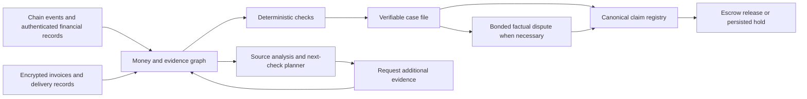

# LANTERN — The Black Hole Ledger

Research and proposal prepared 25 October 2026. Build budget supplied by the user: **12 hours**. Team size, existing skills, sponsor requirements, and available infrastructure are unknown. This document is a proposed architecture and build plan; the application has not been implemented or tested.

## The project in plain English

**LANTERN follows donated money, checks the story told about it, and creates a verifiable case for holding the next payment when the records contradict that story.**

A donor opens one donation and sees three things together: where the funds moved, what the NGO says it achieved, and the independent evidence supporting that statement. Every unexplained link stays visible. A finding opens a case file containing the relevant records, failed rule, and actual escrow transaction.

Suggested pitch: **“An NGO can show you a real payment and still tell a false story. LANTERN links the payment, invoice, and delivery claim, then gives anyone a way to verify a contradiction and enforce the agreed hold on remaining funds.”**

The main demo should be an attack console attached to this case file. A judge changes an authorized claim, tries a second campaign, supplies a visually different copy, or introduces a refund. The interface explains the result and links to contract state. A failed transaction alone is not a successful freeze demonstration.

## What the research established

This is a focused review of primary sources and selected code, not an exhaustive novelty search or a security audit. Do not claim that nobody else has thought of these components.

| Existing work | Established overlap | Consequence for the pitch |
|---|---|---|
| [Crisis Chain, inspected ProofOfDelivery contract](https://github.com/aikhanjum/crisis-chain/blob/405420a14ee8828acc881c49b80356a684c5c47b/contracts/src/ProofOfDelivery.sol) | Weighted receipt, location, peer-NGO, and beneficiary signals can trigger payout. | A confidence score with automated releases is already implemented elsewhere. |
| [Alice v2, inspected Ida contract](https://github.com/alice-si/alice-v2-monorepo/blob/6a3377eeb456145723c03f72999dce329281ef32/contracts/Ida.sol) | Validator-approved outcomes unlock escrow. | Milestone escrow is an established component. |
| [ZKP2P, inspected payment registry](https://github.com/zkp2p/zkp2p-contracts/blob/main/contracts/registries/NullifierRegistryV2.sol) | Authorized writers consume payment identifiers and bind them to settlement intents. | Payment replay prevention is an established primitive. |
| [WFP Building Blocks](https://www.wfp.org/building-blocks) | Organizations coordinate aid and detect unintended overlap on a shared member-managed network. | Aid deduplication is substantial existing work. |
| [Giveth TRACE history](https://forum.giveth.io/t/the-future-of-giveth-trace/842) | Historical donation tracing; sunset discussion includes 2024 shutdown. | Study its concepts; do not assume the archived app is a current starter. |
| [Hypercerts evaluations](https://docs.hypercerts.org/core-concepts/evaluations) | Evidence and separately authored evaluations are modeled explicitly. | Publication by different accounts does not establish independent sources. |
| [Consensix donation-tracking PoC](https://consensixlabs.com/blog/2026-03-30/transparent-charitable-donation-tracking-an-accountability-layer-for-charitable-giving/) | Donation, allocation, invoice hash, delivery hash, and refund records. | Attaching documents to an on-chain timeline is close prior art. |
| [ZK AidShield demo](https://zk-aidshield.vercel.app/mission) | The project's own demo describes private eligibility, escrow, vendor restrictions, and replay rejection. Its implementation was not inspected in this review. | Private one-time aid claims are also an existing demo concept. |

Detailed source boundaries, licenses, and inspected functions are in [research-github.md](research-github.md) and [research-existing-solutions.md](research-existing-solutions.md).

## Three differentiators to demonstrate

### 1. A verifiable case file for each intervention

Display the exact reason for a hold. Example: an NGO-authorized claim states that payment P settled 100,000 INR, while an authenticated provider record for the same P states 70,000 INR. The case identifies both signed records, their common identifier, the violated condition, the verification result, and the escrow state change.

Objective contradictions use contract-verifiable evidence. Anybody can submit the appropriate case; the platform backend is not the sole judge. Real-world disputes that require interpretation use a disclosed dispute mechanism. A timeout is labeled a missing-proof hold, not a finding of guilt.

This makes enforcement inspectable. It is stronger than showing a red AI score without a reproducible reason.

### 2. Evidence provenance and a targeted next check

Link each assertion to its authenticated source, known controlling organization, time, and claim. Three records issued by the same party should not be counted as three independent confirmations. Unknown relationships remain unknown.

A small rule-based planner selects an actionable next check: payment-source evidence for uncertain settlement, delivery acknowledgement for uncertain arrival, or a refund record for a later reversal. The prototype can explain the choice using the unresolved rule and amount at stake. It should not claim statistically optimal sampling without the required model and data.

Public, unpredictable selection after a committed batch can reduce an NGO's ability to prepare only the items it knows will be inspected. Physical checks still require available, credibly enrolled verifiers. The system cannot autonomously manufacture independent evidence.

### 3. Claims stay consistent across reports, chains, and time

One expense can legitimately be shared by multiple donors. Its cumulative allocated amount must remain within the verified eligible invoice amount and the verified net settlement. A report referencing an existing allocation does not create another allocation.

If a later authenticated refund reduces net spending, affected claims are marked for correction. A milestone cannot quietly remain fully justified by a payment that has been reversed. One canonical registry coordinates claims from supported chains; local spending authorizations must be bound to that registry's finalized decisions.

These properties are a proposed integration, not a claim of novel cryptographic primitives.

## How all ten supplied features fit

| Supplied feature | Corrected role in LANTERN | 12-hour treatment |
|---|---|---|
| 1. ZK receipt nullifiers | Private proof of an authenticated registered receipt; stable expense identity across campaigns; separate claim nonces and cumulative allocations. | Prioritize canonical registry and authorization. Use a working existing proving example for one narrow private claim; do not label an ordinary hash as ZK. |
| 2. Perceptual hash forensics | Find candidate visual copies for investigation. Similarity is not proof of forgery, and client-submitted hashes are not trustworthy by themselves. | Run locally over consented synthetic images, show matches and false-positive controls; never slash on this signal alone. |
| 3. Bayesian impact scoring | Experimental, dependency-aware model to rank uncertain claims for follow-up. Priors and evidence likelihoods need justification. | Show evidence coverage and separate illustrative model estimates; do not describe synthetic calibration as real-world accuracy. Model scores do not authorize slashing. |
| 4. Autonomous circuit breakers | Enforce donor-agreed spending limits, proof deadlines, and objective fault responses. | Real persisted hold, nonce/replay tests, and scoped pause. Refunds cover remaining refundable assets, not already-spent funds. |
| 5. ZK budget commitments | Prove a bounded sum over a complete committed set without disclosing every amount. | Share proof infrastructure with the private-claim path if practical. A separate complete batch circuit is an extension; do not imply one is working if it is not. |
| 6. Cross-chain fund reconstruction | Link supported transfers, swaps, and bridges with authenticated transaction/message IDs; record rates and fees. | One route across two chains, with a recorded replay of actual testnet events as a presentation fallback. Unsupported hops are explicit gaps. |
| 7. UMA optimistic oracle | Bonded resolution for precisely stated disputes that cannot be decided by a simple cryptographic rule. | Adapter and local lifecycle demonstration; label any time acceleration or mock result. Full live arbitration is outside a short demo window. |
| 8. Encrypted evidence vault | Client-side authenticated encryption, committed records, selective disclosure, scoped key access. | Real browser encryption and decryption with synthetic private documents. Threshold key management integration is optional. |
| 9. ERC-4337 gasless field operations | A sponsor pays gas, with restricted account permissions where supported. | Reuse an already-working provider/example. Session keys and passkeys are wallet implementation features, not automatic guarantees of ERC-4337. |
| 10. Purpose-bound ERC-1155 allocations | Represent category budgets or disbursement rights while the vault controls underlying assets. | Keep transfers restricted or internal; enforce recipient/category rules at redemption. Use ordinary supported tokens for swaps/bridges; preserve the purpose obligation in the ledger. |

All ten belong in the full design. Completing ten independent production integrations from scratch in twelve hours is not a credible promise. The live demo must clearly distinguish working components, signed-provider sandbox records, adapters, and future work.

Relevant primitives: [Semaphore scope/nullifiers](https://docs.semaphore.pse.dev/faq), [Circom proof semantics](https://docs.circom.io/getting-started/proving-circuits/), [dHash limitations](https://github.com/benhoyt/dhash), [ERC-4337 paymasters](https://eips.ethereum.org/EIPS/eip-4337), [ERC-1155 balances](https://docs.openzeppelin.com/contracts/5.x/erc1155).

## Architecture

### Financial observation

Observe registered wallets and supported protocols. Join bridge source and destination events using protocol identifiers and confirmed status. Treat retries, reorgs, and pending finality explicitly. A temporal graph can be acyclic when it represents individual events, even if money later returns to a previous address.

ERC-20 transfers alone do not prove a swap's economic result or uniquely identify the ownership of commingled funds. Read protocol-specific data and state when available. When attribution is contractual or pro rata, label it as accounting attribution. When a link is guessed, label it as a candidate rather than verified.

For the 50 ETH story, record actual input/output token units, transaction-time conversion basis, and fees at each stage. Do not add ETH, stablecoin, and INR quantities together. The Sankey should use a disclosed common accounting basis or separate units.

Choose one supported lane from the [current CCIP testnet directory](https://docs.chain.link/ccip/directory/testnet), then confirm endpoints and supported tokens before implementation. CCIP is a transport dependency, not a universal historical tracing service.

### Fiat and invoice authentication

Bind provider-originated payment evidence to payment ID, sender/payee binding, amount, currency, status, timestamp, and purpose/claim reference when present. An NGO-uploaded screenshot does not establish those facts independently.

For the demo, a clearly labeled sandbox can issue signed payment records. That proves the verifier and contract behavior under the stated issuer model; it does not prove integration with a real bank. A production connector could use supported signed statements, a payment attestation service, or suitable web/email proofs. [ZK Email](https://docs.zk.email/getting-started) authenticates signed email properties; it does not establish that the sender's commercial assertion is true. [TLSNotary](https://tlsnotary.org/docs/faq/) documents source verification and important on-chain integration limits.

Keep invoice authenticity, settlement, delivery, and long-term impact as separate claims. A real payment does not prove goods arrived; arrival does not prove a project caused a measured social improvement.

### Stable identities, nullifiers, and private amounts

A candidate canonical expense key can be derived from a protocol domain, authenticated issuer, and issuer-fixed high-entropy receipt identifier. The identifier must be bound to the authenticated record. Neither campaign ID nor an NGO-selected replacement salt may change the economic-event identity. New IDs issued by a colluding vendor remain an oracle problem; link and limit underlying payment references too.

Use a canonical registry for every supported campaign. A stable expense key identifies a record; a claim nonce identifies an authorized operation. A one-use spend nullifier is a different object. Do not mark the entire invoice consumed after its first partial allocation if partial cofunding is supported.

For a simple public-amount prototype, track cumulative allocations against each registered expense. A more private version can consume committed allocation notes and create a remainder note, with a conservation proof. That is extra circuit/state-machine work and should not be claimed as done by a Boolean mapping.

A proof must bind the record commitment, accepted registry root, amount/range conditions, intended recipient/action, registry domain, and authorized claim. Different secrets must not let an applicant register alternate versions of the same expense. Registry admission and issuer authentication are part of the security design.

For a budget sum proof, range constraints and an aggregate bound are necessary but insufficient. The expense set must be complete and tied to an authoritative committed ledger; otherwise the prover can simply omit inconvenient expenses. Public remaining budget also reveals aggregate expenditure when total budget is public.

### Privacy

Encrypt documents in the browser using authenticated encryption and a fresh nonce. Store ciphertext in a suitable store. Keep decryption keys out of public responses, analytics, URLs, and server logs. Use salted/hiding commitments for sensitive data; an unsalted hash of a predictable document can be guessed.

Publishing a document commitment proves a commitment existed at a given block time. A public observer cannot validate the document's meaning merely by looking at the hash. Ciphertext availability and key recovery also need explicit handling.

Beneficiary credentials should use a scope appropriate to a delivery or acknowledgement period, not a global public beneficiary identifier. Public wallet, amount, and timing metadata may still reveal patterns. Private dispute evidence requires a defined access path for authorized resolvers; posting raw names, GPS coordinates, or confidential CIDs in an oracle assertion defeats the privacy goal.

### Confidence, holds, and disputes

Use separate decision lanes:

1. **Invalid submission:** bad proof/signature or unauthorized caller; reject it. Do not attribute an outsider's invalid submission to the NGO.
2. **Objective authorized contradiction:** two valid NGO-authorized records break a deterministic rule; anyone can submit the verifiable case and trigger the specified hold.
3. **Incomplete evidence:** hold under an agreed deadline/exposure rule; do not label it proven fraud.
4. **Ambiguous field evidence:** request independent corroboration or initiate a bonded dispute.
5. **Model suspicion:** prioritize review, explain reasons, and preserve uncertainty.

The freeze must persist in a successful transaction. A top-level revert removes its state changes and logs. See [EIP-140](https://eips.ethereum.org/EIPS/eip-140). Repeated relayer submissions of the same signed operation should be idempotent, not counted as malicious intent. A publicly copied receipt cannot be a free mechanism to freeze somebody else's campaign.

UMA can implement a defined challenge lifecycle, but an unchallenged assertion is acceptance under its rules, not mathematical proof of delivery. The configured resolver, challenge period, economic assumptions, and access to evidence must be disclosed. [OOv3 implementation](https://github.com/UMAprotocol/protocol/blob/master/packages/core/contracts/optimistic-oracle-v3/implementation/OptimisticOracleV3.sol).

Hold only the affected remaining escrow or milestone where policy permits. Automatic slashing should be reserved for well-defined proven misconduct, not a visual similarity score, a missing record, or an unverified allegation. Multi-chain action has finality/message delays; already-completed external payments cannot be undone by the registry.

## The demo story

Use a water-infrastructure campaign and one clearly labeled 50 ETH-equivalent scenario. Recorded steps may include a swap, one bridge, and a signed sandbox fiat payout. Clearly mark synthetic amounts and actors rather than suggesting a real NGO deployment.

1. **Open the donor case file.** The flow ends at a local vendor. Separate badges show settlement, invoice, delivery, and unresolved links.
2. **Show an honest claim.** A valid signed record clears the configured checks and the contract releases a small tranche. Show the actual transaction.
3. **Show legitimate cofunding.** Two donors allocate 60% and 40% of an expense. Both pass. An annual report can reference those claims without consuming them again.
4. **Let a judge overclaim.** The NGO authorizes another allocation in a second campaign. The case exposes the excessive allocation against the canonical record and the configured hold persists. Replaying an identical submitted request does not create a new claim.
5. **Change a real signed record.** Alter an amount without its issuer's authorization. The verifier rejects the altered submission. To freeze the NGO for submitting it, require a separately valid NGO signature binding that submission and a defined verifiable offense.
6. **Show a genuine invoice with contradictory settlement evidence.** The NGO says a specific payment P settled 100,000 INR; the authenticated P record says 70,000 INR. The case identifies that exact contradiction. Merely having a partly paid invoice is not automatically fraud.
7. **Show dependence.** Three documents originate from the same known source. The planner asks for a payment-provider or delivery-source check rather than increasing trust three times.
8. **Apply a refund.** The supporting net expense falls; the affected report shows a correction obligation. A refund is not automatically misconduct.
9. **Try an outsider replay.** The attack fails to create a new NGO-authorized claim and cannot maliciously freeze unrelated funds.
10. **Open the privacy view.** The donor sees the reason and verification result; the private document remains unreadable without the appropriate access.

For a five-minute presentation, show steps 1, 2, 4, 6, and 10. Keep the other attacks available for questions.

## Test the requested 30% forgery condition honestly

Prepare a labeled synthetic fixture with ten original receipts, seven valid and three malicious, plus separate replay attempts. The evaluation runner keeps ground truth separate from the verifier inputs.

The three malicious cases can be: a signed receipt with its amount altered; a counterfeit issuer signature; and an NGO-authorized payment assertion contradicted by the authenticated record for that exact payment. Explain that this evaluates those attack classes under the configured issuer assumptions. It does not establish detection of every possible forged receipt.

Add negative controls: two valid receipts using one template, legitimate partial payments, legitimate cofunding, a transport retry, and a delayed record. Measure rejected malicious claims, accepted legitimate claims, false holds, verification latency, and persisted escrow state. Report actual measured results only after running the tests.

Include a fully colluding vendor/NGO scenario whose records appear consistent. If independent evidence is absent, the correct output is unresolved or policy-held, not a fabricated claim of certainty. This is an important honesty boundary in the challenge.

Random audit math can supplement this: under independent sampling, a 30% fraud rate and a reliable check give 1 - 0.7^13 = approximately 99.03% probability of finding at least one fraud in thirteen checks. This is conditional, does not identify all fraud, and is not a substitute for authenticating each submitted record.

## Twelve-hour execution plan

The schedule below is a scope guide for an experienced small team, not a delivery guarantee. With one developer, optional integrations should be explicitly deferred.

| Elapsed time | Deliverable and gate |
|---|---|
| 0–1 h | Agree on one scenario and evidence schema. Fund testnet wallets. Confirm one bridge lane. Run an existing proof example now if ZK is to be shown live. |
| 1–3 h | Implement escrow, canonical expense registry, authorized claims, partial allocation, and one persisted hold path. Verify outsider replay does not freeze it. |
| 3–5 h | Create signed-provider sandbox fixtures, browser encryption, document commitments, and deterministic evidence checks. Show real signature verification. |
| 5–7 h | Build the donor case-file UI and graph. Decode one supported route, using verified recorded testnet events if live waiting is impractical. Display unknown edges. |
| 7–9 h | Connect the working proof path, case submission, source-dependency view, and next-check explanation. Add one visual-copy detector. Optional model estimates remain labeled. |
| 9–10 h | Run adversarial fixtures and negative controls. If time remains, add an already-familiar sponsored transaction provider or local oracle adapter. |
| 10–12 h | Fix failures, verify contract state/explorer links, rehearse the five-minute story, record a backup, and prepare the disclosure slide. |

Do not leave the actual contract hold, one private proof if promised, and the cross-chain trace until the last hour. Do not attempt a new generic bank scraper, multiple bridges, a new calibration dataset, or a production key-management system during this window.

## Suggested implementation boundaries

Keep the initial contract surface small: `PurposeVault`, `ClaimRegistry`, and `CaseVerifier` (which may be combined where practical), plus imported verifier/standard components. Keep graph extraction, similarity search, and experimental probability calculations off-chain. Persist their necessary commitments or decisions, not every image comparison.

The case view needs only a few strong screens: donor timeline, claim detail with source lineage, and attack console. Avoid spending half the hackathon on generic charity registration and donation forms.

Use selected patterns from maintained primitives. The inspected Crisis Chain files declare MIT licensing, Alice's repository is GPL-3.0, Semaphore is MIT, and the inspected UMA implementation declares AGPL-3.0-only. Reuse requires respecting the license of the actual files used. Historical code and source availability are not audit certificates.

## Answers for judges

**Why blockchain?** A shared allocation registry and escrow rule must apply across organizations and reports without the NGO being able to rewrite the history or unilaterally override the specified payment condition. The source authenticity boundary still exists.

**What is new?** The implemented combination of supported multi-hop reconstruction, source-aware evidence checks, canonical allocation accounting, refund corrections, and publicly verifiable intervention cases. The primitives and several neighboring features have clear prior art.

**Does ZK prove the water tank exists?** No. It proves a defined relationship about authenticated committed records while hiding selected data. Delivery truth depends on the declared sources and dispute process.

**Can the NGO and vendor collude?** Yes. Independent payment and delivery evidence, unpredictable checks, and bonds can constrain or expose some collusion. If every accessible source colludes, the system must not claim certainty.

**What if evidence is simply late?** Mark it pending and apply the agreed deadline or exposure cap. Missing evidence and proven falsity receive different statuses.

**Can a stranger freeze a campaign?** Only a valid case satisfying the policy should trigger it; copying an old public receipt or submitting an invalid proof is insufficient.

**What actually worked in the demo?** Show a disclosure table with real contract transactions, real cryptographic verification, recorded events, synthetic financial/field actors, and deferred connectors. Update it from the actual build results.

**Why should we remember this project?** Every important decision has a case file: the claim, the evidence, the contradiction or missing proof, and the enforceable next step.
